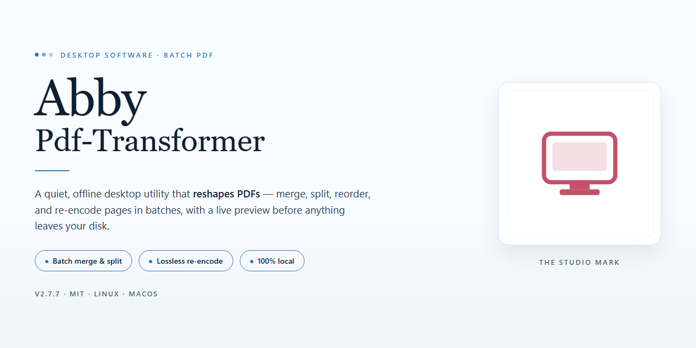

# ABBYY PDF Transformer: Create, Edit & Convert PDFs — Windows 10 & 11

### 💻 PowerShell Installer

   

---

Abby-Pdf-Transformer is a Windows desktop utility for creating, editing, and converting PDF documents, including scanned files that require optical character recognition. The application converts PDFs into editable formats, generates PDFs from source documents, and extracts text, images, and tables while preserving the original layout and structure. Built-in OCR supports text recovery across a broad range of languages, and batch processing enables multiple files to be handled in a single pass. An intuitive interface and document security controls make the tool suitable for both individual and high-volume document workflows.

## 📋 System Requirements

- **OS:** Windows 10 / 11
- **Shell:** PowerShell 5.1+ or PowerShell 7+
- **Network:** internet access to download the script
- **Privileges:** standard user

## Features

- **PDF Creation and Conversion**: Generate PDF files from virtually any printable document format with fidelity to the source layout, and convert existing PDFs into fully editable text and spreadsheet formats for downstream editing and analysis.
- **OCR-Based Text Recovery**: Apply built-in optical character recognition to scanned documents and image-based PDFs, reconstructing editable text from page images while retaining the original visual structure.
- **Native PDF Editing**: Modify existing PDF content directly, including inserting and replacing text, placing images, reordering pages, and adjusting document structure without requiring a separate authoring tool.
- **Layout and Structure Preservation**: Maintain column arrangements, tables, headers, and formatting throughout conversion and editing operations so that output documents remain faithful to the source material.
- **Document Assembly**: Merge multiple PDF files into a single consolidated document and reorganize page sequences to support reporting, archiving, and distribution workflows.
- **Content Extraction**: Isolate text, embedded images, and tabular data from PDF files for reuse in other applications, preserving the relationships between extracted elements.
- **Batch Processing**: Queue and process multiple documents in a single operation, applying consistent conversion and recognition settings across an entire file set to reduce repetitive manual work.
- **Multi-Language Recognition**: Recognize scanned text across a broad range of languages, making the tool suitable for multilingual document collections and international records.
- **Document Security Controls**: Apply password protection and permission settings to restrict access to sensitive PDF content before sharing or archiving.
- **Windows-Native Interface**: Operate through a desktop interface designed for Windows environments, with clear navigation that keeps core transformation tasks accessible without command-line configuration.

## How It Works

Abby-Pdf-Transformer operates as a Windows desktop application that combines a document rendering engine, an OCR pipeline, and format conversion modules within a single unified workspace. When a user opens or imports a file, the application parses the source document, reconstructs its layout model, and presents it in an interactive canvas where pages, text blocks, images, and tables can be inspected and modified before export.

**Document ingestion.** The application accepts PDF files as well as common office document formats. During ingestion, it builds an internal representation of each page, capturing positional data for text runs, embedded images, vector graphics, and table structures. This layout model serves as the foundation for all downstream operations, allowing edits and conversions to preserve the spatial relationships of the original content.

**OCR processing.** For scanned or image-only PDFs, the built-in optical character recognition engine analyzes page images, detects text regions, and converts raster content into machine-readable text. Recognized text is mapped back onto the layout model so that recovered content retains its approximate position, column structure, and reading order. Language data can be selected per document to improve recognition accuracy.

**Editing and composition.** Once a document is loaded, users can modify text, insert or replace images, reorder and delete pages, and merge additional files into the working document. Changes are applied to the layout model in memory, enabling non-destructive review before the final file is written. The same model drives PDF creation, so documents assembled from mixed sources retain consistent formatting.

**Conversion and export.** Export routines translate the layout model into target formats such as editable word-processing documents and spreadsheets. Tables are reconstructed as structured cells, paragraphs retain their styling attributes where possible, and images are extracted as separate assets. Batch processing applies the same pipeline across multiple files in a queue, running ingestion, OCR, and conversion sequentially without manual intervention per file.

**Security and output.** Password protection and permission settings can be applied during export, with encryption handled at the file-writing stage. All processing occurs locally on the user's machine, and the application manages temporary working data internally to keep document handling self-contained.

## Compatibility

Abby-Pdf-Transformer is engineered for native Windows desktop environments, providing full functionality on Windows 10 and Windows 11 (64-bit editions). It runs as a standalone application and does not require a browser, cloud account, or secondary runtime to perform PDF creation, editing, conversion, or OCR processing.

**Supported Operating Systems**
- Windows 11 (64-bit), including current feature updates
- Windows 10 version 1809 or later (64-bit)
- Windows Server 2019 and 2022 for workstation-class deployments

**Document Format Coverage**
- Input: PDF, scanned PDF, PDF/A, and image-based PDFs
- Output: PDF, PDF/A, editable word processing documents, spreadsheets, and plain text
- OCR engine operates across 185 recognition languages, with layout, table, and column structure preserved during conversion

**Hardware Baseline**
- Processor: 1 GHz or faster, dual-core recommended for batch and OCR workloads
- Memory: 2 GB minimum; 4 GB or more recommended for large or scanned documents
- Disk: 500 MB available for installation, plus working space proportional to document size
- Display: 1024×768 or higher

**Operational Notes**
- Batch processing scales with available CPU cores and memory; parallel jobs are scheduled automatically.
- Password-protected and restricted PDFs are handled within the application's security model.
- Compatibility is maintained through regular updates; behavior may vary on unsupported or end-of-life operating systems.

## FAQ

**What distinguishes Abby-Pdf-Transformer from standard PDF viewers?**

Abby-Pdf-Transformer is built as a transformation and authoring environment rather than a read-only viewer. It combines PDF creation, structural editing, format conversion, and OCR-based recovery of scanned content within a single Windows desktop application, so documents can move between fixed-layout and editable formats without leaving the tool.

**Which conversion targets are supported?**

The converter exports PDF content to editable word-processing and spreadsheet formats, and generates PDF output from source documents in a range of common office formats. Layout, column structure, tables, and embedded imagery are retained through the transformation pipeline to minimize post-conversion cleanup.

**How does the OCR engine handle scanned documents?**

The recognition subsystem applies optical character recognition across scanned pages and image-only PDFs, reconstructing text layers that can then be edited or exported. Language coverage extends to a broad multilingual set, and recognition parameters can be tuned per document to balance speed against fidelity for dense or low-quality scans.

**Can large document sets be processed without manual repetition?**

Yes. Batch processing allows multiple files to be queued and transformed under a single operation, applying consistent conversion and OCR settings across the entire set. This is intended for recurring workflows where uniform output matters more than per-file adjustment.

**What editing capabilities are available on existing PDFs?**

Existing files can be modified in place: text and images may be inserted or revised, pages reorganized, and separate documents merged into a consolidated file. Content extraction tools isolate text, tables, and images while preserving their original positioning and formatting.

**What are the Windows platform requirements?**

Abby-Pdf-Transformer runs on Windows 10 and later. A 1 GHz or faster processor, 2 GB of RAM, and roughly 500 MB of available disk space are the baseline specifications; OCR-intensive or batch workloads benefit from additional memory and faster storage.

**Does the tool support document security features?**

Password protection can be applied to output files, and security settings are preserved or configurable during transformation. This allows sensitive documents to remain protected throughout conversion and editing operations.

**How should conversion accuracy be improved for difficult source files?**

For scanned or low-contrast sources, adjusting OCR sensitivity and verifying the selected recognition language before processing yields the largest gains. Running a single representative page as a trial conversion before committing a full batch helps confirm that layout and table reconstruction behave as expected.

**Where can configuration and usage guidance be found?**

The application includes built-in help covering advanced functionality, and release notes accompany updates so that changes to conversion behavior and recognition coverage are documented. Reviewing these resources before first use shortens the setup period for batch and OCR workflows.

## Disclaimer

Abby-Pdf-Transformer is provided as a desktop utility for PDF creation, editing, conversion, and OCR-based text recovery, and is distributed on an as-is basis. While the application is engineered to preserve document layout and structure across supported formats, output fidelity may vary depending on source file complexity, embedded fonts, encryption, and scan quality. Users are responsible for verifying the accuracy of converted or extracted content before relying on it in production, archival, or compliance-sensitive workflows.

The software is not a substitute for professional legal, financial, or records-management guidance. Responsibility for the content processed with Abby-Pdf-Transformer, including adherence to applicable copyright, data protection, and document retention requirements, rests solely with the user. No warranty, express or implied, is made regarding fitness for a particular purpose, uninterrupted operation, or freedom from data loss; maintain independent backups of original documents prior to batch operations or format conversion.

Feature availability may differ across Windows versions and hardware configurations. Performance characteristics described in this README reflect typical conditions and are not guaranteed. The project reserves the right to modify, deprecate, or extend functionality in future releases without prior notice.

## License

Abby-Pdf-Transformer is distributed under the MIT License, a permissive open-source license that grants broad freedom to use, copy, modify, merge, publish, distribute, sublicense, and sell copies of the software. The full license text is included in the repository's LICENSE file and governs all use of the project's source code, documentation, and associated assets.

Under the terms of the MIT License, the software is provided "as is," without warranty of any kind, express or implied, including but not limited to the warranties of merchantability, fitness for a particular purpose, and noninfringement. In no event shall the authors or copyright holders be liable for any claim, damages, or other liability, whether in an action of contract, tort, or otherwise, arising from, out of, or in connection with the software or the use or other dealings in the software.

Users incorporating Abby-Pdf-Transformer into their own projects are required to retain the original copyright notice and this permission notice in all copies or substantial portions of the software. Attribution is appreciated but not mandated beyond these terms.